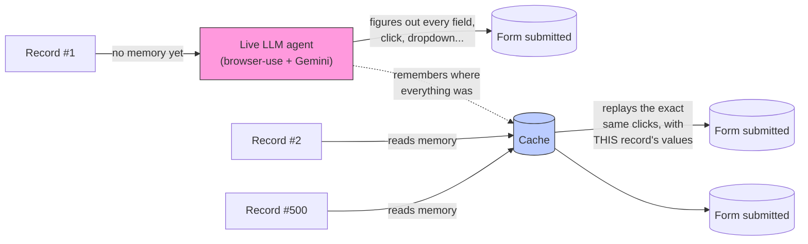

# 1. Overview — what is this thing?

## The problem, with real numbers

Picture a list of 500 people that need to be entered into some internal
system's "Add Person" form — the kind of form every ERP, CRM, or admin
panel has: first name, last name, email, phone, a department dropdown,
an employment-type dropdown, a salary field, a notes box, a checkbox,
maybe fifteen to twenty fields in total, one submit button at the end.

An LLM-driven browser agent (this project uses an existing library called
`browser-use`, paired with Google's Gemini model) can absolutely fill in
that form correctly, one record at a time, entirely on its own — look at
the page, decide "this text box's label says First Name, type the
record's first_name into it," click, look again, decide the next action,
repeat until the whole form is filled and submitted. It's genuinely
capable of doing this without ever being told *where* on the page
anything is in advance; that's the whole value of using an LLM for it
instead of a fixed script.

The catch is what that capability costs when you need it 500 times in a
row for the *same shape of form*. Every single field the agent fills in
costs the same "look at the page, decide, act" LLM round-trip whether
it's the first record or the five-hundredth — the model has no built-in
memory that says "I already figured out where the department dropdown is
an hour ago, for a different person." A representative estimate for this
project's own ~18-field DataDesk form: 10 to 15 LLM calls per record
(one for a click here, a batch of a few fields there, a dropdown that
needs an extra "wait for it to render" step, and so on). For 500 records,
naively, that's somewhere between five thousand and seventy-five hundred
LLM calls — to fill in the literal same form, five hundred times, paying
full price every single time for something that, structurally, never
actually changes between one record and the next: *where the fields are*.

That's the actual problem this project exists to solve. Not "can an LLM
fill in a form" — that part already works, and isn't this project's
contribution. The contribution is: **can we make record #2 through record
#500 nearly free**, while keeping the LLM fully available as a fallback
for anything genuinely new or unexpected, so the system never becomes
brittle the way a hand-written, fixed automation script would be the
moment the target page changes even slightly.

## Why this gets rehearsed on a fake app first

The actual, real-world destination for this is a company's internal ERP
— a live system where a mistake isn't just an annoyance, it's wrong data
sitting in a system other people and other processes depend on. Before
pointing anything resembling this at that, the entire approach needed to
be built and stress-tested somewhere safe, disposable, and — crucially —
*checkable*.

That's what **DataDesk** is: a small, purpose-built React web app with a
Supabase database behind it, modeling a simple "People management" admin
panel. It has an "Add Person" form with the same kinds of fields any real
ERP form would have — plain text inputs, a date field, several dropdowns
with a fixed set of valid options, a checkbox, a free-text notes box —
and a "People" list view where existing entries can be searched for and
edited. It was built specifically so this project could rehearse the
whole idea against something realistic, without any of the real stakes.

The Supabase part matters more than it might first seem. Because
DataDesk's data lives in a database this project can query directly and
independently, there's a genuine, trustworthy way to check "did this
actually work" that doesn't depend on trusting the automation's own
opinion of itself — which, as it turns out, is an assumption you should
never make (more on exactly why in `02_HOW_CACHING_WORKS.md` and the bug
story in `00_FULL_OVERVIEW.md`). A real destination ERP likely won't offer
that same direct-database-read convenience — see `05_PORTABILITY.md` for
what that difference actually means in practice.

## The one idea this whole project is built around

> **The first record that needs a given form teaches the system where
> everything on that form is. Every record after that just replays what
> was learned, dropping in its own values — no LLM call needed, unless
> something genuinely new comes up.**

Record #1 is expensive (a real LLM figures out the whole form, click by
click, dropdown by dropdown, all the way to submit). Records #2 through
#500 are nearly free — plain browser automation (a library called
Playwright, with zero AI involved) replaying the exact clicks record #1's
run discovered, except with *this* record's own values dropped in, at
whatever speed a real browser can actually run. No LLM call, unless
something the cache doesn't know how to handle comes up — in which case
it falls back to the LLM for *just that one thing*, fixes it, and
remembers the answer so no future record ever has to pay for it again
either.

Run that math again with this design: instead of 5,000-7,500 LLM calls
for 500 records, you're looking at roughly 10-15 calls for record #1,
plus a small, bounded number of extra calls scattered across the batch
for anything genuinely new (a field the seed record happened to leave
blank, say, or a dropdown selector that briefly stops matching) — often
landing in the range of a few dozen total LLM calls for the *entire*
500-record batch, not five thousand. That's not an incremental
improvement; it's a fundamentally different cost curve, and it's the
entire reason this project exists in its current caching form rather than
just running the plain LLM-agent version five hundred times.

## What "it" is made of, concretely

- **`browser-use`** — an existing, external, open-source library (not
  something built as part of this project) that gives an LLM a real,
  controllable Chrome browser and a decision loop: look at a structured
  snapshot of the current page, decide one action, perform it, look
  again, repeat, until it believes the task is finished. This is the
  component that actually *understands* what a form looks like — "this
  looks like a dropdown, its options probably need a moment to render
  after I click it," "this input's label says Last Name" — reasoning this
  project never needed to reimplement, only wrap and watch.

- **Gemini** — specifically `gemini-3.5-flash-lite`, on Google's free
  tier, the actual model making browser-use's decisions. The free-tier
  choice matters operationally: free tiers come with real rate limits
  (a certain number of requests per minute, and a separate, much larger
  daily cap), and this project's own testing ran into both kinds more
  than once — see `03_OPERATIONS.md` for how to tell them apart when it
  happens, and `00_FULL_OVERVIEW.md`'s bug story for how those limits
  showed up during real batches.

- **Playwright** — a completely separate, plain browser-automation
  library with no AI involved at all: "find this exact element, click
  it," "type this exact text into this exact input." This is what does
  the fast, cheap part — replaying an already-learned interaction with a
  new value, at ordinary browser speed. Playwright has no idea what a
  "department" is; it only ever does exactly what it's told, which is
  precisely why it's fast and free of LLM cost.

- **A small SQLite database** (`storage/cache.sqlite3`) — the actual
  cache. A plain, local file, not anything exotic; what makes it a
  "cache" isn't the storage technology, it's what gets put into it (see
  `02_HOW_CACHING_WORKS.md`) and how the rest of the system decides
  whether to trust and reuse a given row.

- **DataDesk + Supabase** — the test target described above: a real web
  form, backed by a real, independently-queryable database, that this
  whole system practices against before ever being pointed at anything
  that matters for real.

- **A FastAPI backend and a one-page dashboard** — the part that actually
  runs everything: accepts "run this batch" requests, drives the whole
  cold-run/replay/verify/reconcile process end to end, and shows live
  progress in a browser as it happens. See `03_OPERATIONS.md` for how to
  actually use it.

## What a "good" batch actually looks like when you watch it run

If you were watching the dashboard live during a clean 100-record batch,
here's roughly what you'd see happen, in order:

1. **Record 1 starts, tagged "no cache yet, using live agent."** You'd
   see a stream of `step` lines — plain-English descriptions of what the
   LLM is doing right now ("Click the 'Add Person' button," "Select
   'Marketing' from the department dropdown," "Submit the form") — for
   maybe 10-15 steps, taking anywhere from 15 seconds to a couple of
   minutes depending on how Gemini's API is behaving that moment.
2. **The instant record 1 finishes, everything else that was waiting
   starts moving all at once** — up to a configured number of records (15,
   in this project's own testing) running in genuinely parallel Chrome
   windows, each one tagged "replaying from cache."
3. **A wall of `hit` lines** — one per field, per record, each one nearly
   instantaneous, since nothing here is waiting on an LLM. A single
   record with ~18-24 cacheable interactions (fields plus a few plain
   clicks to open dropdowns, open the form, etc.) might finish in well
   under a second of actual "thinking" time, bottlenecked only by however
   fast the real browser can click and type.
4. **Occasionally, a `miss` line**, followed by a `step` (the scoped live
   fallback figuring out just that one thing), then the record continues
   — this should be rare in a healthy run, and should get *rarer* as the
   batch progresses, since each miss self-heals the cache for whoever
   hits it next.
5. **A final tally**: "N succeeded, M failed," followed by an
   independent verification pass reading the real database directly and
   reporting exactly how many of the individual fields — not records,
   *fields* — actually ended up correct, and whether any records are
   missing from the database entirely despite the automation believing
   they succeeded (a distinction that turns out to matter a great deal;
   see the next doc for why).

That's it for the big picture. Next: `02_HOW_CACHING_WORKS.md`, for
exactly how "remembers where everything was" works underneath — what gets
saved, what doesn't, and what happens the moment something the cache
doesn't recognize comes up.
