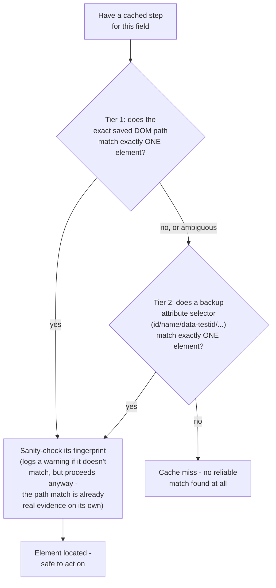
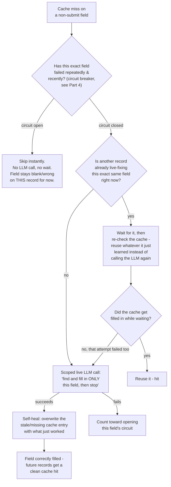
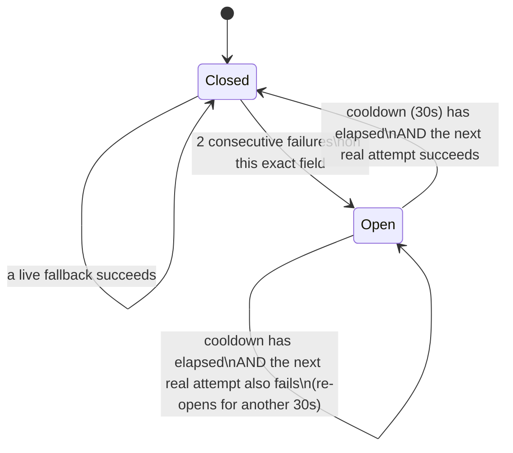

# 2. How the caching actually works

Builds on `01_OVERVIEW.md`'s big idea. This is the mechanism underneath
"the first record teaches the system, everyone else replays" — what
actually gets remembered, how a replay decides whether it can trust what
it remembers, and what happens the moment it can't.

---

## Part 1 — What gets remembered, and what deliberately doesn't

While record #1 fills in the form live, a small watcher sits alongside
browser-use and looks at every single action it takes — not to change
anything, purely to observe — and decides, for each one, whether it's
worth remembering.

For each action worth keeping, it saves a row that looks roughly like
this (this is the actual shape of the data, described in plain terms, not
literal code):

| What's saved | Example | Why it matters |
|---|---|---|
| **Lookup key** | `"department"` | how a later replay finds this row again — a field name for anything tied to a specific field, or a made-up key for a click that isn't (e.g. "open the form" doesn't correspond to any field) |
| **Action type** | `select_dropdown` | tells replay *how* to perform it — click / type text / pick a dropdown option / toggle a checkbox |
| **Where it is on the page** | an exact DOM path | the primary way to relocate the same element next time |
| **Backup attributes** | `{id: "dept", name: "department"}` | a second, independent way to find it if the exact path stops matching |
| **A fingerprint** | a hash of the element's tag + stable attributes | a sanity check — confirms the element found later still genuinely *looks like* the one that was originally cached |

**What's deliberately never saved: the value that was typed or selected.**
Record #1 might type "Marketing" into the department dropdown. What gets
remembered isn't "this dropdown = Marketing" — it's "this specific
dropdown, wherever it is on the page, is where the `department` field
lives." When record #47 replays that same cached row later, its *own*
department value (say, "Engineering") gets dropped into that same
dropdown instead. If the cache stored literal values, every record after
the first would silently get the first record's answers for every field
— that's the difference between a genuine cache and an accidental
recording, and getting it wrong here would make the whole system useless
regardless of how fast it ran.

**How the system knows which field a typed value belongs to, without
being told DataDesk's field names in advance:** the watcher takes
whatever text browser-use just typed (or whichever dropdown option it
just picked), and compares it — using the same kind of value-normalizing
comparison the final grading step uses — against every field in record
#1's own data. Whichever field's expected value matches is the one this
action gets tied to. If nothing matches closely enough, the action simply
isn't cached at all; better to fall back to a live call for that one step
next time than to cache a guess that can't be justified.

**Checkboxes are the one deliberate exception to that rule**, and the
reason is worth spelling out because it was a real, concrete bug early in
this project's life (see `V2_BUGS_FIXED.md` #3): a checkbox click carries
no typed text to reverse-match against anything — there's no "value" to
compare, just a click. The first version of this system treated a
checkbox click as a generic, fieldless click, and on replay, a generic
click just *toggles whatever state the box currently happens to be in* —
which is only correct for records that happen to want the same boolean
value the very first record wanted. Every record whose desired value was
the opposite ended up wrong, silently. The fix: a click on an element
that's specifically a checkbox gets matched to a field by *name*, not
value — using the raw HTML `id`/`name` attribute browser-use already
exposes (DataDesk, like most forms, names its checkbox input after the
field it represents) — and cached as its own distinct action type. On
replay, that action type reads the box's *current* checked state first,
and only clicks if it doesn't already match what this particular record
actually wants. State-aware, not a blind toggle.

---

## Part 2 — Finding the same element again, reliably

A page reload doesn't guarantee the exact same DOM path resolves to the
exact same element every single time — a slightly different render order,
a dynamically-generated id, or (as came up directly in this project's
testing) a form field simply not being on the page at all yet because a
dependent dropdown hasn't rendered its options — any of these could make
a naive "just re-use the saved path" approach fragile. So locating a
cached element on replay goes through a small, deliberate sequence rather
than trusting one single signal:

Why three signals instead of just relying on the exact path: the path is
the most *specific* signal, so it's tried first, but specificity is also
exactly what makes it fragile to change. The backup attribute selector
(built from whichever of a handful of common, meaningful HTML attributes
the element actually has — an id, a name, a `data-testid`, and similar)
is less exact but often more durable, since ids and names tend to survive
minor page changes better than an element's exact position in the DOM
tree does. The fingerprint — a hash built from the element's tag plus a
filtered set of its "stable" attributes (explicitly excluding anything
that looks like transient hover/focus/animation state, so two snapshots
of the genuinely same element don't hash differently just because a class
briefly toggled) — isn't used as a third independent lookup strategy at
all; it's a *sanity check* on whatever tier 1 or 2 already found. A
mismatch there gets logged as a signal worth watching over time, not
treated as an automatic failure, since the locator match itself is
already real evidence the right element was found.

If neither tier finds exactly one match, that's a clean cache miss — no
partial credit, no guessing at "probably the right one" among several
candidates.

---

## Part 3 — What happens on a miss (the part that keeps this system from being brittle)

A cache miss is not the end of the story for that field — it's the exact
moment the LLM comes back into the picture, but scoped as narrowly as
possible: not "redo the whole form," just "find and correctly fill in
*this one field*, and then stop." Here's the full decision a miss walks
through:

The "is another record already fixing this" branch deserves its own
explanation, because it was a real, measurable problem this project hit
directly (`V2_BUGS_FIXED.md` #6): when a dozen or more records start
replaying at roughly the same moment — which is exactly what happens the
instant the seed cache finishes populating and every waiting record
proceeds at once — several of them can independently discover the *exact
same* missing field before any one of them has finished fixing it. Left
unchecked, each one, unaware of the others, launches its own redundant
live LLM call for the identical field — a thundering herd, paying for the
same fix multiple times over in the same few seconds. The fix is a small
per-field lock: only one record at a time is ever actually calling the
LLM for a given missing field; every other record that hits the same gap
just waits, and — critically — re-checks the cache *after* waiting rather
than blindly calling the LLM itself, so it picks up whatever the winner
just learned for free. Only the genuinely first record to discover a
given gap ever pays for it, no matter how many records discover it at
nearly the same instant.

**Self-healing is what makes this whole design compound in the system's
favor over time**, and it's worth being explicit about exactly what it
means: the moment a live fallback call succeeds, whatever it just learned
— the element's path, its backup attributes, a fresh fingerprint — gets
written into the cache, overwriting whatever was there before (nothing,
in the case of a genuinely new field; a stale, no-longer-matching entry,
in the case of a page that changed slightly). The *next* record that
needs this same field gets a clean cache hit, as if it had always been
there. A single genuinely new situation — a field the seed record left
blank, say — costs exactly one live LLM call across the *entire* batch,
no matter how many hundreds of records also need that field. This is the
concrete mechanism behind "the cache gets smarter as the batch runs, not
just smart once at the very start" — and it's also directly why, in a
real run of this project, the very first few records in a batch tend to
show slightly more `miss` lines than everything after them: each miss in
those early records is very often the *last* time that particular gap is
ever a miss again for the rest of the run.

---

## Part 4 — The circuit breaker, in depth

The self-healing mechanism above has one dangerous edge case built into
it, and this project ran directly into it once (`V2_BUGS_FIXED.md` #6b):
what happens when a field's live fallback doesn't fail *occasionally*,
but fails **every single time**, because the underlying problem isn't
"this one field is tricky," it's "Gemini's API is genuinely down or
overloaded right now"? Without protection, the per-field lock described
above actually makes this *worse*, not better — it turns "everyone waits
their turn, then benefits from whoever succeeds first" into "everyone
takes their own personal turn to also fail," one record at a time, each
one burning real wall-clock time (multiple retries before an individual
LLM call gives up) before handing the baton to the next record in line to
lose the exact same way. In a real run, this stretched a batch's runtime
enormously and, compounded with a separate bug (a field's failure was, at
the time, incorrectly allowed to mark the *entire record* as failed even
though the actual submit had already succeeded), produced a batch where
72 of 100 records were reported "FAILED" despite every single one of them
having genuinely landed correctly in the database — only one cosmetic
field was ever actually missing.

The fix is a circuit breaker, and it behaves like this:

Concretely: after a field fails its live fallback twice in a row, its
circuit "opens." For the next 30 seconds, every record that hits a miss
on that same field skips the live attempt entirely — no lock wait, no
LLM call, nothing — and just moves on, leaving that field blank or wrong
on that one record for now (a gap the reconciliation pass, described
below, gets a chance to close later). Once the cooldown passes, the next
record to hit that field gets a genuine, real attempt — if whatever was
wrong has cleared up (the API recovered, say), the circuit closes again
and everything goes back to normal on its own, with no manual
intervention needed. If it's still broken, it re-opens for another 30
seconds. This turns an unbounded, batch-runtime-dominating pile-up into,
at most, two real wasted attempts before the system stops hammering
something that clearly can't succeed right now.

**A field being circuit-skipped repeatedly can look, from the outside,
exactly like a caching bug** — a field that's mysteriously never learned,
run after run. This project hit a case of exactly that shape once
(walked through in `00_FULL_OVERVIEW.md`'s bug story): a field kept
failing far more than any other, across multiple otherwise-clean runs,
and the circuit breaker's own protective behavior (correctly refusing to
keep retrying something that clearly wasn't working) made the *real* root
cause briefly harder to spot — the actual problem turned out to be that
the test data being generated was asking for dropdown values that didn't
exist as real options on the target form at all, so every attempt was
*correctly, permanently* doomed, not flaky. Worth remembering: a
consistently, repeatedly failing field is a strong signal to go check the
target system directly, not necessarily a sign the caching logic itself
is broken.

---

## Part 5 — What actually counts as "the record succeeded"

This is a deliberately narrow, and easy to get wrong, definition: **a
record is marked successful if, and only if, the final submit action
worked.** Every other field is optional, in the specific sense that a
record which submitted correctly but has one wrong or blank optional
field still counts as an overall success — because it genuinely did land
in the target system. That's a data-quality gap for later cleanup
(Part 7, below), not proof the automation itself failed.

Two things had to be true at once to make this definition safe, and both
were, in fact, real bugs before they were fixed:

**First: correctly telling the submit step apart from every other cached
step.** A cached form-fill doesn't come labeled "this one's the submit
button" — the system has to infer it, and the first, simpler approach
("whichever cached step happens to have been recorded last") broke in a
genuinely subtle way (`V2_BUGS_FIXED.md` #13): during a live cold run,
the LLM agent did something harmless-looking but disruptive — after
already clicking submit, it re-selected a dropdown value one more time,
perhaps double-checking itself, perhaps just an artifact of how it
decided the task was finished. That redundant action got recorded *after*
the real submit click in the cache's own ordering, and got mistaken for
"the submit step" on every future replay. Since the real submit step is
always replayed with no value at all (a genuine submit click doesn't take
one), every replay ended up trying to set that misidentified "submit"
dropdown to nothing — which always fails, both on cache replay and when
it fell back to a live call (which was, absurdly, being asked to "set
this field to nothing"). Because this misidentified step was treated as
critical, every one of those failures wrongly marked an entire,
genuinely-successful record as failed — even though the real submit
click, now just an ordinary earlier step in the list, had already
succeeded. The fix: identify the submit step by *what it structurally is*
— a plain click tied to no specific field, since every other cacheable
action type only ever gets cached once a specific field has been matched
to it — rather than by *where it happens to sort*. A fieldless click
survives a trailing, redundant action landing after it in a way that
"whatever's last" never could.

**Second: knowing the database write from the submit click actually
finished, not just that the click itself fired.** This one is, if
anything, more dangerous, because when it goes wrong the automation
reports a completely clean success — every field hit, zero errors — while
the record simply never reaches the database at all. It happens because
form submission usually triggers an asynchronous write (the click handler
kicks off a database call and returns immediately, without waiting for
it), and a plain Playwright click likewise returns the instant the click
*event* fires, not once whatever it triggered has actually completed. If
the browser tab then closes right away — freeing up its slot for the next
record, as it should — an in-flight write can get silently aborted
mid-flight. This project's history has three real chapters on exactly
this failure mode (`V2_BUGS_FIXED.md` #2, #14, #15): first, discovering
it existed at all (every replayed record in an early batch reported clean
success while only the cold-run record actually appeared in the
database); then, once a fixed short delay before closing the browser
stopped being enough as real concurrency scaled up (14 records silently
lost despite reporting success, once fifteen browser windows were
genuinely writing to the same database at the same time); and then, in
the process of fixing *that*, briefly making things worse in the opposite
direction — a misunderstanding of exactly when a particular
browser-automation timeout actually fires meant a *slow but completely
real* success could get mistaken for a failure, and did, for 140 records
in one run, every one of which had actually landed correctly. The
eventual, stable fix: instead of guessing at a fixed delay, wait for the
*actual* network response that proves the write happened, with a generous
budget, structured so that a timeout on that confirmation is treated only
as a diagnostic warning — never as a verdict that silently overwrites an
already-correct result.

**The automation's own opinion of what happened is never the final
grade, for exactly this reason.** A separate, independent step reads the
real target database directly — every field, every record — and compares
it against what should be there. That comparison, not `RunResult.success`
and not the hit/miss counters, is the actual source of truth for whether
a batch genuinely worked. See `03_OPERATIONS.md` for what those numbers
look like on the dashboard, and `00_FULL_OVERVIEW.md` for the complete
story of why that separation exists.

---

## Part 6 — Reconciliation: the pass that closes remaining gaps

The main batch's whole design prioritizes speed — an actively broken
field gets skipped (via the circuit breaker) rather than stalling
everything else, which is the right tradeoff *during* a batch but isn't
the state anyone actually wants left behind. Right after the independent
verification pass finishes, a follow-up pass starts on its own, separate
background thread: it looks specifically at fields verification flagged
as wrong, on records that genuinely did land, skips anything whose
circuit is still currently open (no point wasting an attempt on something
already known to be broken right now), and retries just that one field,
on that one record, through the target system's *edit* flow — searching
for the existing entry, opening it, changing the one field, saving —
which is a structurally different task from filling in a brand-new blank
form, and gets its own, separate prompt for exactly that reason.

This pass is deliberately decoupled from whether a new batch is currently
running, so a brand-new batch can start immediately while an earlier
one's cleanup quietly continues underneath it. More on how that isolation
works, and why it matters, in `04_ARCHITECTURE.md`.

---

Next: `03_OPERATIONS.md`, for how to actually run one of these batches,
read what the dashboard is telling you, and figure out what to do when
something looks stuck.
