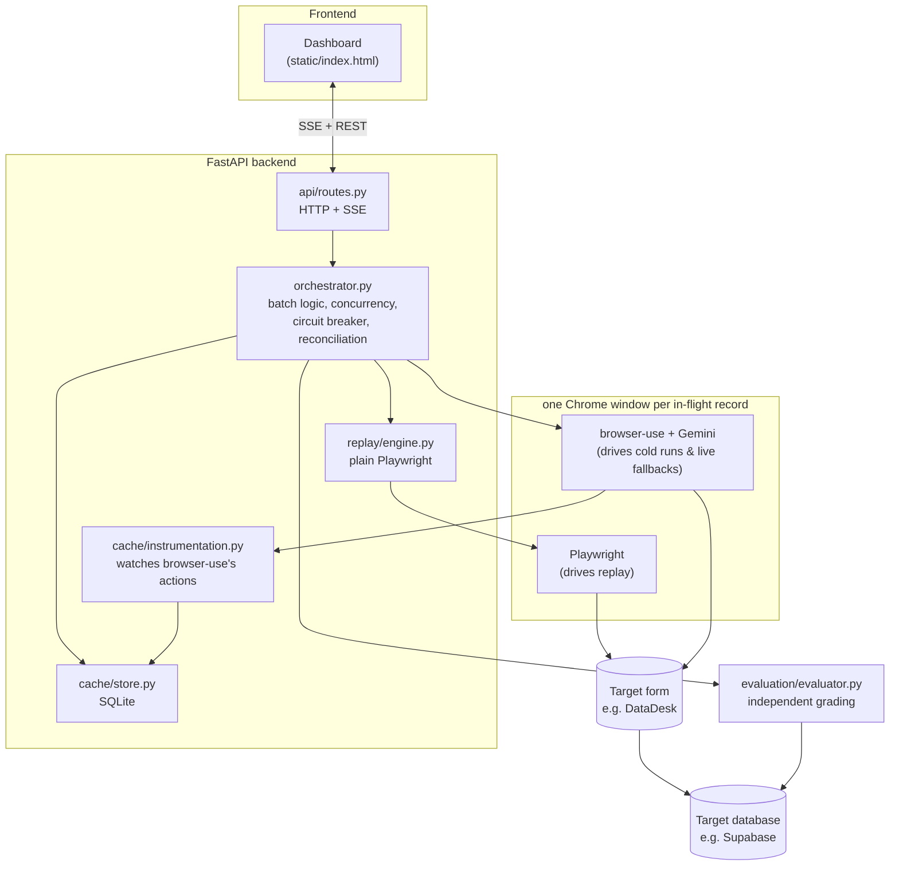
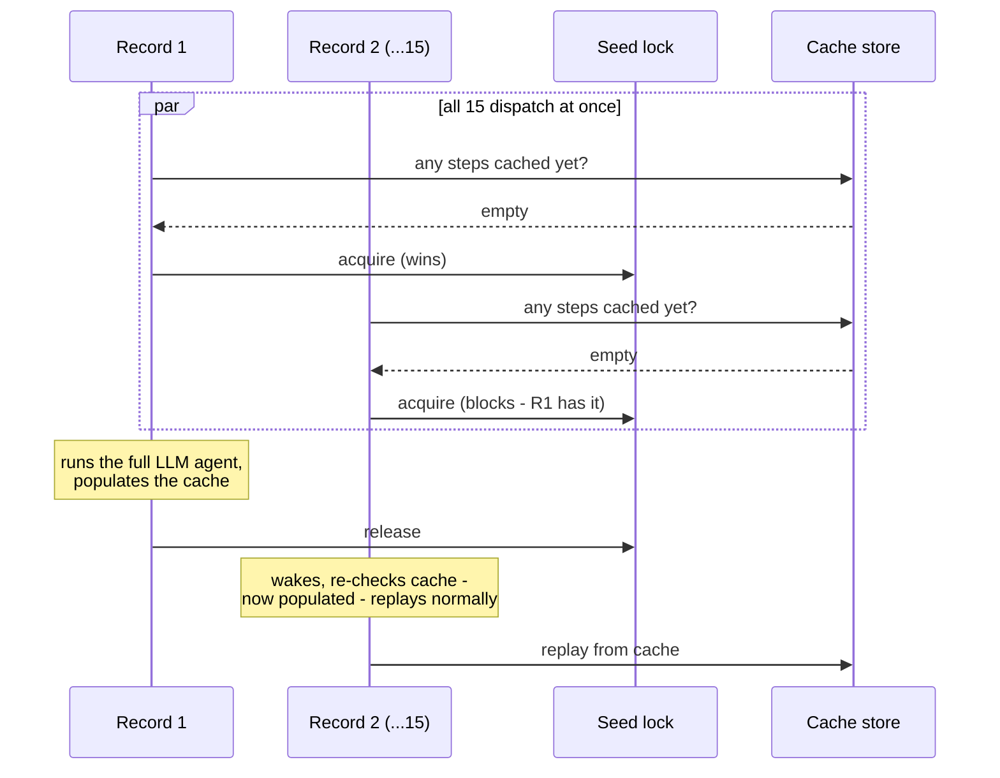
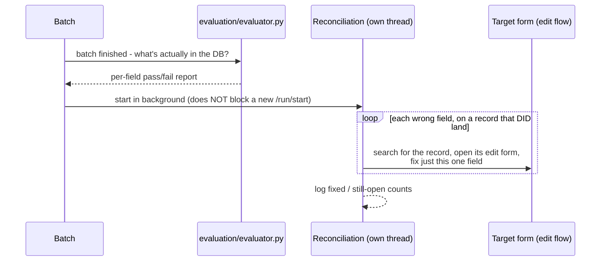

# 4. Architecture — how the pieces fit together

Builds on `02_HOW_CACHING_WORKS.md` (the per-record mechanism) and
`03_OPERATIONS.md` (how to actually run it). This document is about what
happens when a hundred of those single-record mechanisms are running *at
once*, sharing one cache, one database connection, and one background
cleanup pass, without any of them stepping on each other — and about a
whole class of bugs this project found and fixed specifically in that
space, none of which are visible at all when only one record runs at a
time.

---

## Part 1 — The components, and how they actually talk to the same browser tab



One detail here is more load-bearing than it might look at first glance:
**Playwright and browser-use attach to the exact same live browser tab**,
rather than each one launching and owning its own separate browser. This
matters because a single record's work is never purely "replay" or purely
"live agent" — it's usually a mix: plain Playwright replaying most of the
form quickly, then handing off to a scoped browser-use call the instant a
field can't be replayed, then handing control back to Playwright to
continue with the next cached step. For that hand-off to work at all, both
tools need to be looking at, and acting on, the *same* page state — the
same partially-filled-in form, not two independent browser windows that
happen to both be open.

The mechanism that makes this possible: Playwright launches a real Chrome
process with remote debugging enabled on a specific local port, navigates
it to the target form, and *then* browser-use is told to attach to that
exact same debugging port (via a connection parameter it accepts
specifically for this purpose) rather than launching its own browser.
Whether this would actually work as intended — attach to the exact tab
Playwright had already navigated, mid-form, rather than opening a fresh
blank tab of its own — was an open, unverified risk noted early in this
project's design, before any live run had actually exercised it. A real
cold run confirmed it works exactly as needed: browser-use correctly saw
and continued filling in the already-open, already-partially-navigated
form. Worth knowing about specifically because it's a genuine example of
"this could plausibly have not worked" being resolved by *actually
running it*, rather than reasoned about correctly or incorrectly in
advance — a theme that runs through a lot of this project's real history
(see the bug story in `00_FULL_OVERVIEW.md`).

---

## Part 2 — Concurrency: many records, one shared cache, one browser window each

Up to a configured maximum number of records (`MAX_CONCURRENT_REPLAYS`,
15 in this project's own testing) run at once — a small pool of local
debugging ports, each one getting its own, completely isolated,
disposable Chrome browser profile. "Disposable" matters: each record's
browser profile is a fresh temporary directory, used once, then discarded
— no cookies, cached state, or history leaks from one record's browser
session into the next one's.

### The very first moment: who gets to teach the cache?

The genuinely tricky part isn't running 15 records concurrently once the
cache already has something in it — replay is inherently safe to run in
parallel, since every record only ever *reads* cached steps and *writes*
back a self-healed row for a specific field, never conflicting with
another record's read. The tricky part is the very first moment of a
batch against a brand-new, empty cache, when all 15 (or however many)
records start at essentially the same instant, and every single one of
them independently discovers "there's nothing cached yet for this form."

Naively, that's fifteen simultaneous cold runs — fifteen browsers all
independently, redundantly re-discovering the exact same form from
scratch, exactly the fifteen-times cost explosion this whole project
exists to avoid, plus fifteen sets of "what I just learned" all racing to
write into the same cache rows at once.



The actual behavior: only one record is ever allowed to be actively
seeding the cache for a given form at a time, enforced by a real runtime
lock rather than any kind of pre-computed, upfront "here's who goes
first" list. Every other record that finds an empty cache doesn't launch
its own cold run — it simply waits on that same lock, without even
opening a browser yet (so nothing is wasted while waiting), until
whichever record currently holds it finishes. The instant that first
attempt succeeds, the lock releases, and every record still waiting wakes
up, re-checks the cache (now populated), and proceeds straight into fast,
ordinary replay — as if the cache had simply always been there.

**Why "a real runtime lock" specifically, rather than a simpler upfront
split** (e.g., "just always let record #1 in the batch be the one that
cold-runs, and start everyone else a moment later") — this was an actual
design evolution, not a hypothetical: an upfront split only protects
against the thundering-herd problem if the very first cold-run attempt
*succeeds*. If it fails outright (record 1's own LLM calls hit a genuine
API outage right at the start, say, and it never manages to learn
anything at all), a static "record 1 goes first, everyone else starts a
beat later" plan has no mechanism to notice that and correctly hand
seeding responsibility to record 2 instead — every other record would
still independently discover an empty cache and each launch its own
redundant cold run, the exact problem this was meant to prevent, just
delayed by a moment. The lock-based approach handles this automatically:
if the current seed attempt fails, the lock releases regardless, the next
waiting record picks it up, tries again, and so on — one attempt at a
time, retried automatically, until one succeeds — rather than a herd
racing off the instant the first attempt stumbles.

---

## Part 3 — The isolation principle: one record's bad luck must never take down anyone else's good work

This is the single most important architectural rule running through
this whole system, and it exists directly because of a real incident,
not as a hypothetical design goal (`V2_BUGS_FIXED.md` #7): early on, a
brief, real network hiccup (the target form was momentarily unreachable)
raised an unhandled exception deep inside one single record's own
execution path. Because of how the underlying concurrency mechanism
(Python's `asyncio.gather`, used to run every record's work concurrently)
behaves by default, that one exception didn't just fail the one affected
record — it immediately cancelled *every other record still in flight
across the entire batch*, the instant it propagated far enough up. A
transient, one-record network blip turned into the whole batch reporting
zero completed records.

The fix that resulted from this — and that now shapes how every record's
work is structured — is a deliberately broad, explicit exception boundary
wrapped around each individual record's entire execution, at two separate
layers for genuine defense in depth: once around the core "launch a
browser, run cold or replay, close the browser" sequence for a single
record, and again, independently, around the small wrapper that actually
dispatches each record into the concurrent pool. Any exception from
*anywhere* inside a single record's work — a network failure, a browser
crash, something genuinely unforeseen — gets caught, converted into an
ordinary failed result for just that one record, and reported normally,
rather than being allowed to propagate outward and endanger anyone else's
already-good work. A batch of a hundred records, ninety-nine of which are
going perfectly, should never lose all hundred because of the one that
had bad luck — and after this fix, it structurally can't.

This same principle — "one thing's failure must be contained to exactly
that one thing, never allowed to leak sideways into unrelated,
concurrently-running work" — turned out to apply in several other places
too, once concurrency (and, later, a second independent background
process, reconciliation) entered the picture, and each one was its own
real, found bug rather than something anticipated in advance:

**A shared database connection wasn't actually safe once a second
background thread existed** (`V2_BUGS_FIXED.md` #8). The cache's
underlying SQLite connection is shared across the whole process via a
single, reused instance — which was genuinely safe as long as every
caller happened to run on the same thread's event loop, true right up
until the reconciliation pass was introduced, which runs on a real,
separate operating-system thread that can execute at the exact same
moment as a brand-new batch's own thread, by design (see Part 4, below).
Python's own database library is explicit that allowing a connection to
be *used* across threads doesn't automatically make *concurrent* access
from multiple threads safe — the caller has to serialize it themselves.
The fix: every actual database operation now goes through a single lock,
regardless of which thread it's called from, verified afterward with a
deliberately adversarial stress test — eight real threads, each hammering
the database with fifty writes at once, four hundred operations total,
zero errors, no deadlock.

**Two near-simultaneous "start a batch" requests could both slip past
the guard meant to prevent exactly that** (`V2_BUGS_FIXED.md` #9). The
"is a batch already running?" check and the "okay, mark one as running"
write weren't originally one atomic operation — under specific,
unlucky-but-real timing, two requests arriving at nearly the same instant
could both observe "nothing's running yet" before either one had actually
claimed that status, and both proceed to launch a batch, colliding on the
exact same range of local debugging ports. The fix: that check-then-set
sequence is now genuinely atomic, guarded by its own lock.

**A completely unrelated background process's failure could visibly, and
wrongly, disrupt a totally different, currently-running batch's
dashboard** (`V2_BUGS_FIXED.md` #10). Reconciliation, running well after
its own batch has already finished, was originally reusing the same
"something has gone badly wrong" signal the *dashboard* interprets as "the
batch currently being displayed just died" — resetting its Start button,
turning its status indicator red. Since reconciliation can genuinely
still be quietly running long after a brand-new, completely unrelated
batch has already started (that's the entire point of decoupling it, see
Part 4), a reconciliation failure could incorrectly make it *look* like
that new, healthy batch had just crashed. The fix: reconciliation
failures now use their own, distinct signal, one the dashboard displays
without touching anything about whatever batch is currently on screen.

**One run's leftover background activity could quietly bleed into a
different run's saved transcript** (`V2_BUGS_FIXED.md` #11). The
plain-text run log (`Logs.md`) resets at the start of every new batch —
but a reconciliation pass from an *older* batch can still genuinely be
writing to it well after a brand-new batch has already reset the file out
from under it, mixing two completely unrelated runs' output together in
what's meant to be one clean, readable transcript. The fix: every reset
of the log file now hands out a fresh "generation" marker, and every
event carries the marker for the run it actually belongs to — an event
whose marker no longer matches the file's *current* generation is
silently dropped from the saved file (it's still delivered live to anyone
actively watching the dashboard at that moment, just not persisted into
the wrong saved transcript).

**A rare failure path could leave a lock held forever, permanently
disabling a whole workflow** (`V2_BUGS_FIXED.md` #12). Between claiming
the seed lock described in Part 2 and actually confirming that claim,
there's a brief second check against the cache — and if that specific
check happened to fail for an unrelated reason (a disk read error, in
principle), nothing released the lock first. A sufficiently unlucky
failure at exactly that moment would have left that lock permanently
held, silently disabling this system's ability to ever cold-start that
particular form again for the rest of the process's entire lifetime — an
extremely quiet, extremely severe failure mode for something so narrow.
The fix: that check is now wrapped so any failure there releases the lock
before the error is allowed to propagate, degrading to "this one seed
attempt failed" (recoverable, exactly like any other cold-run failure)
rather than a silent, permanent deadlock.

Every one of these, on its own, is a small, specific fix. Together, they're
the reason this system can be trusted to run a hundred-plus records
concurrently, alongside its own background cleanup pass, without one
piece's bad day quietly corrupting or disabling an unrelated piece.

---

## Part 4 — Reconciliation, and why it deliberately doesn't wait for anything



The deliberate choice to run this on its own thread, decoupled from
whether a batch is "currently running" in the dashboard's eyes, means a
brand-new batch can start the instant the previous one finishes — its own
status endpoint, its own live event stream, everything about it works
completely normally — while the previous batch's cleanup quietly
continues underneath, in the background, entirely unnoticed by anything
happening in the new batch. Its own pool of local debugging ports is
deliberately kept in a completely separate numeric range from the main
batch's own pool, specifically so the two processes — main batch and
reconciliation, potentially both genuinely active at the same moment —
can never collide on the same port.

It uses a separate, distinct task prompt (described in `02_HOW_CACHING_
WORKS.md`) from the one used to fill in a brand-new blank form, because
editing an *existing* entry is a structurally different task — it starts
by searching for the right record, opens its pre-filled edit form rather
than a blank one, and only then changes the one specific field that
needs fixing. This edit flow is also, unlike the main batch, not cached
and replayed — it's treated as a low-volume cleanup path that simply runs
live, via the LLM, every single time, since the volume involved (however
many fields verification found wrong, typically a small fraction of the
whole batch) doesn't justify building and maintaining a second, parallel
caching system just for it.

---

## Part 5 — What's actually stateful, and where it lives

| State | Lives in | Survives a restart? |
|---|---|---|
| Learned DOM steps | `storage/cache.sqlite3` | yes (on purpose) |
| Per-batch progress | in-memory, inside the backend process | no |
| Circuit breaker state | in-memory, inside the backend process | no — resets clean on restart |
| Full run transcript | `Logs.md` | yes, until the next batch starts and resets it |
| "Did it actually work" | the target system's own database | yes — it's the real, permanent source of truth |

Worth noticing here: neither in-flight progress nor circuit breaker state
is meant to be durable, and that's intentional rather than an oversight —
restarting the backend mid-batch isn't something this system is designed
to gracefully resume from (any in-progress batch would need to be
re-started fresh afterward), but a restart also means every field's
circuit breaker starts clean, closed, with no memory of whatever was
failing before — a reasonable default, since whatever caused a field to
be failing before a restart may well have changed by the time anything
runs again.

---

## Part 6 — File map

```
api/routes.py           HTTP endpoints, SSE, background-thread wiring
orchestrator.py         the actual batch logic: cold vs replay, concurrency,
                         seed lock, circuit breaker, reconciliation
cache/store.py          SQLite: the cached (workflow, field) -> DOM locator rows
cache/instrumentation.py watches a live browser-use run, decides what's
                         worth caching, reverse-matches typed values to fields
cache/fingerprint.py    a DOM-element identity hash, used as a sanity check
replay/engine.py        plain Playwright: locate + perform a cached step,
                         zero browser-use/LLM involvement
agent/runner.py         thin wrapper around browser-use's own Agent
agent/prompts.py        the task prompts (cold run, single-field fallback,
                         reconciliation edit)
evaluation/evaluator.py independent grading against the real target database,
                         plus delete_all_records() for a clean-slate reset
data/models.py          Record, RunResult, BatchReport, and the other
                         plain data shapes passed between every piece above
progress.py             the SSE broadcaster
logfile.py              mirrors every event into Logs.md, with the
                         generation-token protection described in Part 3
static/index.html       the dashboard
```

`data/models.py` deserves one specific mention: it's where `RunResult`
(the outcome of one record — success or failure, and why) and
`BatchReport` (the independent verification result described in
`02_HOW_CACHING_WORKS.md` and `03_OPERATIONS.md`) are actually defined as
plain data. Every piece of this system that needs to communicate "here's
what happened" to another piece — the orchestrator reporting to the API
layer, the evaluator reporting the real grade, the dashboard displaying
both — passes these same plain shapes around rather than each layer
inventing its own. Keeping "what happened" (`RunResult`) and "was it
actually correct" (`BatchReport`) as two genuinely separate data shapes,
never conflated into one, is itself a direct reflection of the "never
trust the automation's own self-report" principle that runs through this
entire project.

---

Next: `05_PORTABILITY.md` — given everything above, how much of it is
actually tied to DataDesk specifically, and what would genuinely need to
change to point this whole system at a different site tomorrow?
