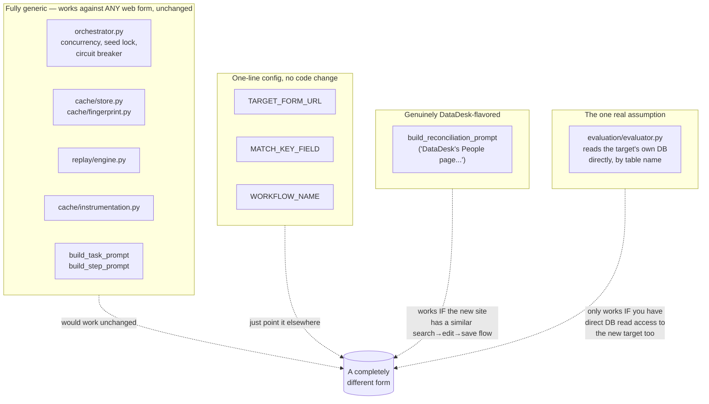

# 5. Is this DataDesk-specific?

Builds on `04_ARCHITECTURE.md`. This is the question worth answering
honestly, in real depth, rather than just reassuringly: **if this whole
system got pointed at a completely different form-based website
tomorrow — not DataDesk, something with a totally different shape,
different fields, a different framework — how much of it would just
work, and how much would need real changes?**

Short answer: **the caching engine itself — the entire mechanism that
makes this fast — has no DataDesk-specific knowledge anywhere in it and
would work unchanged against almost any form-based site.** A small,
clearly-bounded set of edges around that engine are DataDesk-flavored,
and exactly one of them is a real structural assumption that a typical
real-world destination (a genuine company ERP) likely wouldn't satisfy.
The rest of this document walks through *why* that's true, piece by
piece, rather than just asserting it.

---

## The split, visually

---

## Walking through each piece, in depth

### The entire caching engine — genuinely, structurally generic

`orchestrator.py`'s concurrency model, seed lock, and circuit breaker
(all of `04_ARCHITECTURE.md`) operate purely on *field names from your
own record data* and *runtime timing* — nothing about a dropdown being
called "department" versus "cost center" versus "team," nothing about a
form having exactly eighteen fields versus four versus fifty, changes how
any of that logic behaves. The seed lock doesn't know or care what form
it's protecting; it just ensures one cold run at a time, for whatever
`workflow_name` happens to be configured.

`cache/store.py`'s schema (`04_ARCHITECTURE.md`'s file map) stores
exactly two categories of thing: a lookup key (a field name from *your*
data, or a synthetic key for a fieldless click) and a DOM locator (a path,
some backup attributes, a fingerprint hash). None of that has any notion
of DataDesk baked in — the same table structure, the same lookup
strategy, would store and retrieve locator information for a completely
different site's completely different DOM just as well.

`cache/fingerprint.py`'s hashing approach (an element's tag plus a
filtered set of stable HTML attributes, deliberately excluding anything
that looks like transient hover/focus/animation state) is a general
statement about what "the same element" means across any web page built
with ordinary HTML — it isn't tuned to any particular site's markup
conventions.

`replay/engine.py`'s tiered locate-and-act strategy (`02_HOW_CACHING_
WORKS.md` Part 2) is built entirely out of standard Playwright operations
— click, fill, select an option, check a checkbox's current state — the
same four kinds of interaction essentially every HTML form in existence
is built from. There's no DataDesk-specific selector, id pattern, or
class name referenced anywhere in it.

**The practical claim, stated plainly: point `TARGET_FORM_URL` at a
different site, clear the cache, and run a batch — record #1 would cold-
run and teach the cache the new form's layout exactly the same way it did
for DataDesk, with zero code changes to any of the files above.** This
isn't a hopeful projection; it follows directly from the fact that none
of those files contain a single line of DataDesk-specific logic to begin
with.

### `cache/instrumentation.py`'s field-matching — also generic, by construction

It's worth being specific about *why* this piece doesn't need DataDesk
knowledge either: it never hard-codes field names anywhere. What it does,
for every action browser-use takes, is take whatever text was typed (or
option selected) and compare it — using the same normalized-comparison
approach the grading step uses — against *your own record's* own field
values, whatever those happen to be named. If your record has a field
called `cost_center` instead of `department`, this same matching logic
correctly ties a typed value back to `cost_center` with no changes at
all, because it was never looking for "department" specifically in the
first place — it was always looking for "whichever of this record's own
fields has a value that matches what was just typed."

### The task prompt — already written the way you'd want it for a new site

This is worth reading directly rather than taking on faith. The actual
prompt handed to the live agent for filling in a brand-new form says,
verbatim:

> *"Enter the following field values exactly as given, matching each
> value to the form field with the closest matching label... Do not
> invent, guess, or fill in values that were not given above... After all
> fields are entered, submit the form."*

— followed by a plain list of whatever fields and values happen to be in
*your* record. It never mentions DataDesk, never mentions "People," never
references any specific field by name. That's not a coincidence or an
oversight; it's already written in exactly the generic style you'd want
for pointing this at an unknown, different form tomorrow. The same is
true of the scoped single-field fallback prompt used when a cache miss
happens — it's built purely from a field's *name* and *value*, both of
which come from your record data, never from anything DataDesk-specific.

### Three configuration values — genuinely one-line changes

- **`TARGET_FORM_URL`** — obviously just the new site's address.
- **`MATCH_KEY_FIELD`** (defaults to `email`) — whichever field uniquely
  identifies one of *your* records. There's nothing that requires this to
  be an email address specifically; it could be an order number, an
  employee ID, a SKU — whatever your own data uses as its natural unique
  identifier. Both the reconciliation pass (to search for an existing
  record) and the grading step (to match a record to its database row)
  use whatever this is configured to.
- **`WORKFLOW_NAME`** (defaults to `datadesk_people_form`) — purely a
  label used to namespace cache rows internally, so that if this system
  is ever used against *multiple* different forms at once, their learned
  steps don't collide in the same cache. Call it anything descriptive.

### The one place a specific site is actually named: the reconciliation prompt

Read directly, it says: *"You are on DataDesk's People page (a
list/table of existing people)... use the search box if the list is
long... click that row's edit action to open the edit form..."* — this one
genuinely, explicitly assumes a specific kind of interface: a searchable
list view, with a visible edit action per row, leading to a pre-filled
edit form. That's a very common admin-panel pattern — most CRUD-style
management interfaces (which is what most "add/edit records in a
database" business tools look like, ERPs very much included) work exactly
this way — but it's not a universal one. A wizard-style, multi-step form;
an interface with no search capability at all; a system where editing an
existing entry requires an entirely different navigation path than
described here — any of these would need this specific prompt rewritten
to describe the *actual* edit flow of the new target, before
reconciliation specifically (not the main batch — the main batch's create
flow doesn't depend on this at all) would work correctly against it. This
is real, but it's a single, contained function to rewrite, not an
architectural change — everything about *how* that new prompt gets used
(the scoped single-field edit, the same live-agent-only approach) stays
exactly the same.

### The one real structural assumption: grading reads the database directly

This is worth being genuinely honest about, because it's the one place
where "this is a fair, deliberate simplification for the test-harness
stage of the project" and "this wouldn't hold up against a real ERP" are
both true at once. Grading a batch currently works by directly querying
the target system's own database table and comparing every field, row by
row, against what should be there. That's not incidental — DataDesk was
specifically *built* with a directly-queryable Supabase table behind it
*so that* this project could have a completely trustworthy, independent
way to check its own work while everything else was being built and
debugged. Without that, there would be no reliable way to answer "did
this actually work," short of trusting the automation's own self-report
— which, as `02_HOW_CACHING_WORKS.md` and the bug history both make
clear at length, is explicitly something this project has learned,
repeatedly and concretely, never to do.

**A real company ERP will very likely not offer that same kind of direct
database read access** — for entirely reasonable reasons: production
databases are usually locked down, fronted by their own application
layer, and not something an external automation script gets to query
directly. Pointing this system at a real ERP tomorrow would mean this one
piece — and only this piece — needs a genuinely different approach.
Realistic alternatives, in roughly increasing order of how much new work
they'd need:

- **Read back through the target's own UI**, the same way the automation
  entered the data in the first place — search for the record it just
  created, and compare what's displayed against what was submitted. Slower
  and itself dependent on the UI rendering correctly, but it needs no new
  access this system doesn't already have.
- **Lean more heavily on the replay engine's own hit/miss and submit-
  confirmation signals** (`02_HOW_CACHING_WORKS.md` Part 5) as the primary
  evidence of correctness, accepting a lower bar of independent
  verification than direct database comparison provides.
- **A narrow, purpose-built, read-only integration**, if the target
  system happens to expose any kind of reporting API, export function, or
  read-only reporting database replica — something that gives independent
  read access without needing the same level of access as a full database
  connection.

None of these are drop-in replacements for what direct Supabase access
currently provides — each is a real, deliberate design decision to make
for whatever the actual destination system turns out to be — but this is
also, notably, the *only* piece of the whole system where that's true.

---

## A worked example: pointing this at a completely different kind of form

To make the split above concrete rather than abstract, imagine swapping
DataDesk's "add a person" form for something structurally quite
different — an internal invoice-entry system, with fields like invoice
number, vendor name, line-item description, amount, a currency dropdown,
a due date, and an approval-status dropdown, backed by whatever database
that real system happens to use.

- The caching engine doesn't need to know any of those field names in
  advance. Record #1's cold run would teach it — click here for invoice
  number, this dropdown is currency, this one is approval status — the
  exact same way it learned `department` and `employment_type` for
  DataDesk, because none of that logic was ever specific to DataDesk's
  field names to begin with.
- The task prompt, unmodified, would correctly instruct the live agent to
  "enter invoice_number = INV-10234, vendor = Acme Supplies, amount =
  1250.00... matching each value to the form field with the closest
  matching label" — because that's already exactly what it says, just
  with a different set of field names substituted in from the new
  record data.
- If this invoice system has a searchable list of existing invoices with
  an edit action per row (extremely likely, for this kind of system),
  the reconciliation prompt would need its wording updated to describe
  *that* system's specific navigation instead of DataDesk's "People
  page" — a rewrite of one function, not a redesign.
- If this invoice system is a real internal tool without a Supabase-style
  open database connection available, grading would need one of the
  alternative approaches described above instead of a direct table
  query — the one genuinely new piece of design work in the whole
  migration.

Everything that actually makes this project *worth having* — the
caching, the concurrency, the circuit breaker, the self-healing, the
never-trust-your-own-self-report discipline — travels to that
completely different form with zero changes at all.
