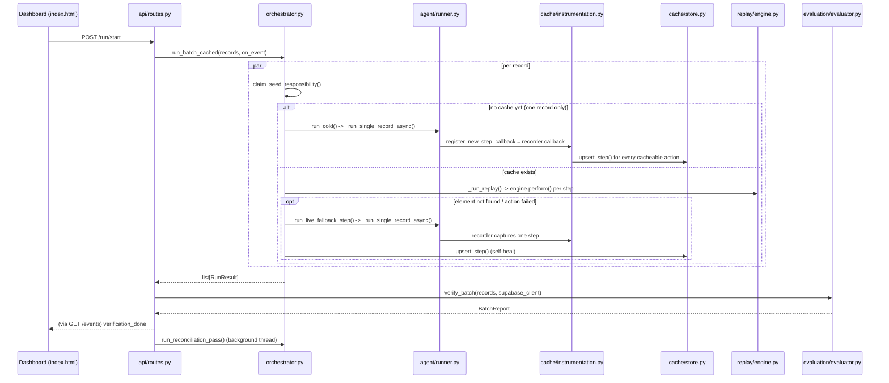

# 6. Code Walkthrough — following one batch through the actual code

Builds on `04_ARCHITECTURE.md` and `05_PORTABILITY.md`, but this one's
different on purpose: **this is the code**, function by function, in the
order it actually executes. Every function named below is a real function
you can open and read — this doc just narrates what's in it and why, so
scrolling through the real files afterward feels like a re-read, not a
first read.

Read this after `00`-`05` (or after just `00_FULL_OVERVIEW.md`), not
instead of them — this assumes you already know *why* caching/circuit
breakers/seed locks exist and focuses purely on *where in the code* each
piece lives and *how one call leads to the next*.

---

## The file map, as a table of contents

```
main.py                    -- uvicorn's entry point, does almost nothing itself
api/routes.py               -- every HTTP endpoint; kicks off / reports on batches
orchestrator.py             -- the brain: per-record logic, concurrency, locks, circuit breaker
agent/
  prompts.py                 -- builds the actual English text sent to the LLM
  runner.py                   -- wraps browser-use's Agent class, v1's old entry point
cache/
  store.py                    -- SQLite: the actual cache table
  instrumentation.py          -- watches a live agent run, decides what's worth caching
  fingerprint.py               -- our own "is this the same element" hash
replay/
  engine.py                    -- plain Playwright: replays a cached step, no LLM
evaluation/
  evaluator.py                 -- reads Supabase directly, grades a finished batch
  normalizers.py                -- makes "5/14/1990" and "1990-05-14" compare equal
data/
  models.py                     -- every Pydantic schema (Record, RunResult, BatchReport, ...)
  loader.py                      -- reads sample_records.json into Record objects
config.py                    -- every environment variable, in one place
progress.py                  -- in-process pub/sub feeding the live dashboard
logfile.py                   -- mirrors the same events into Logs.md
storage/results_store.py     -- persists the last BatchReport to disk
compare.py                   -- standalone script, not part of the running app (v1 vs v2 benchmark)
```

If you only remember one thing from this table: **`orchestrator.py` is
where almost everything you'd call "the actual logic" lives.** Every other
file is either a dumb data holder, a thin wrapper around an external
library (Playwright, browser-use, Supabase), or a small focused utility
`orchestrator.py` calls into.

---

## Part 1 — Starting the process

`main.py` is seven lines. It builds a `FastAPI()` app and mounts
`api.routes.router` onto it. That's it — when you run `uvicorn main:app`,
this is the file uvicorn imports, but every actual behavior comes from
`api/routes.py`.

`api/routes.py` defines every endpoint as a small `@router.get`/`@router.post`
function. Two matter for a normal run:

- **`GET /`** just returns `static/index.html` — the dashboard is a single
  static HTML file (plus its own JS) that talks to the backend purely
  through the endpoints below. It's not templated or server-rendered.
- **`POST /run/start`** is what the dashboard's Start button actually calls.

```python
@router.post("/run/start")
def run_start(request: RunRequest) -> dict:
    records = load_records(request.records_path)
    with _status_lock:
        if _status["state"] == "running":
            raise HTTPException(409, "A batch is already running.")
        _abort_event.clear()
        _status.update(state="running", current=0, total=len(records), error=None)
    threading.Thread(target=_run_batch_in_background, args=(records,), daemon=True).start()
    return {"status": "started", "total": len(records)}
```

Four things happen here, in order:
1. `data.loader.load_records()` turns your JSON file into a `list[Record]`
   (see Part 6 below for what a `Record` actually is).
2. `_status_lock` guards a check-then-set on a module-level dict — this is
   what stops two almost-simultaneous clicks of Start from launching two
   batches that would collide on the same Chrome debug ports.
3. `_status` flips to `"running"` — this dict is what `GET /status` reports
   back, and it's the ONLY thing shared between the request thread and the
   background thread below (besides the event queue).
4. A brand-new `threading.Thread` is spawned running
   `_run_batch_in_background(records)`, and the HTTP handler returns
   immediately — the actual batch hasn't even started when this response
   goes out. This is why the dashboard needs `GET /events` (Server-Sent
   Events) to show anything: the HTTP response here carries no progress at
   all, just an acknowledgment that the thread was started.

`_run_batch_in_background` (still in `api/routes.py`) is what that thread
actually runs:

```python
def _run_batch_in_background(records: list) -> None:
    generation = logfile.reset(len(records))
    on_event = lambda event: _broadcast_and_log(event, generation=generation)
    run_batch_cached(records, on_event=on_event, abort_check=_abort_event.is_set)
    _status["current"] = len(records)
    supabase_client = create_client(SUPABASE_URL, SUPABASE_SERVICE_ROLE_KEY)
    report = verify_batch(records, supabase_client)
    save_report(report)
    _status["state"] = "done"
    ...
    threading.Thread(target=_run_reconciliation_in_background, ...).start()
```

Three calls carry the entire batch: `run_batch_cached` (does the actual
form-filling — this is `orchestrator.py`), `verify_batch` (grades what
landed in Supabase — `evaluation/evaluator.py`), `save_report` (writes the
result to disk — `storage/results_store.py`). Everything else in this
function is event plumbing and error handling. Note the `on_event` closure:
this one lambda is threaded through literally every layer below it, all
the way down into individual field-level cache hits — it's how a click that
happens deep inside `replay/engine.py` ends up as a line on your dashboard
half a second later.

---

## Part 2 — `orchestrator.py`, top to bottom

This file is ~1100 lines and does the real work. Reading order that
matches how it actually executes for one record:

### `run_batch_cached()` — the entry point orchestrator.py exposes

```python
def run_batch_cached(records, *, workflow_name=WORKFLOW_NAME,
                      max_concurrent=MAX_CONCURRENT_REPLAYS,
                      on_event=None, abort_check=None) -> list[RunResult]:
    ...
    results = asyncio.run(_run_many_concurrent_async(records, ...))
    ...
    return results
```

This is a plain sync function (so `api/routes.py`'s background thread can
call it directly) that immediately hands off to `asyncio.run(...)`, which
spins up an event loop, runs `_run_many_concurrent_async`, and blocks this
thread until every record is done.

### `_run_many_concurrent_async()` — the concurrency pool

```python
async def _run_many_concurrent_async(records, *, max_concurrent, ...):
    port_pool: asyncio.Queue[int] = asyncio.Queue()
    for i in range(max_concurrent):
        port_pool.put_nowait(i)

    async def _run_one(record):
        port_offset = await port_pool.get()
        try:
            if abort_check is not None and abort_check():
                return RunResult(..., success=False, error_message="aborted before starting")
            result, _ = await _run_record_cached_async(record, port_offset=port_offset, ...)
            return result
        finally:
            port_pool.put_nowait(port_offset)

    return list(await asyncio.gather(*(_run_one(r) for r in records)))
```

This is the actual mechanism behind "up to 15 records at once." It's a
classic bounded-worker-pool pattern using an `asyncio.Queue` as a
semaphore: `max_concurrent` integers (`0`, `1`, `2`, ...) are pre-loaded
into the queue as tokens. Every record's coroutine calls `port_pool.get()`
first — if all tokens are checked out, that `await` just parks there until
one comes back via `put_nowait` in the `finally` block. Whichever integer
a record gets becomes its Chrome debug port offset (`CDP_DEBUG_PORT +
port_offset` in the next function down), which is *why* two records can
never collide on the same port — the queue physically only hands out
`max_concurrent` distinct offsets at a time. `asyncio.gather` is what
actually runs all of these coroutines concurrently on one event loop —
concurrency here is not threads, it's cooperative async tasks, all
context-switching at every `await` point (a Playwright network call, a
lock acquire, an `asyncio.sleep`).

### `_run_record_cached_async()` — everything for ONE record

This is the biggest function in the file and the one worth reading slowly.
Structurally:

```python
async def _run_record_cached_async(record, *, store, workflow_name, port_offset, ...):
    path_variant = resolve_path_variant(record)
    must_seed = await _claim_seed_responsibility(workflow_name, path_variant, store)
    cached_steps = [] if must_seed else store.get_steps(workflow_name, path_variant)

    try:
        with tempfile.TemporaryDirectory(...) as profile_dir:
            async with async_playwright() as playwright:
                context = await playwright.chromium.launch_persistent_context(
                    profile_dir, headless=False, args=[f"--remote-debugging-port={port}"])
                page = context.pages[0] if context.pages else await context.new_page()
                await page.goto(TARGET_FORM_URL)
                cdp_url = f"http://127.0.0.1:{port}"

                async with page.expect_response(lambda r: ...SUPABASE_TABLE... in r.url, timeout=30000):
                    if must_seed:
                        run_result, metrics = await _run_cold(record, cdp_url=cdp_url, ...)
                    else:
                        run_result, metrics = await _run_replay(record, cached_steps, page=page, cdp_url=cdp_url, ...)
                ...
    finally:
        if must_seed:
            _release_seed_responsibility(workflow_name, path_variant)

    store.record_run(...)
    _emit(on_event, {"type": "record_done", ...})
    return run_result, metrics
```

Read this as five real steps:

1. **`resolve_path_variant(record)`** — a one-liner (see below) that decides
   which "shape" of the form this record needs. Always `"default"` for
   DataDesk today.
2. **`_claim_seed_responsibility(...)`** — this is the seed-lock decision
   from `02_HOW_CACHING_WORKS.md`, made real. It returns `True` only if
   *this* record is now responsible for a cold run; every other
   concurrently-dispatched record that also finds an empty cache blocks
   inside this call (on an `asyncio.Lock`) until the winner finishes.
3. **A real Chrome window is launched** via Playwright, with its own
   temporary profile directory and its own `--remote-debugging-port`. This
   is the literal "one isolated browser per record" mechanism — nothing
   fancier than a CLI flag Playwright passes to Chromium.
4. **`page.expect_response(...)`** wraps whichever of `_run_cold` /
   `_run_replay` this record needs. This is bug #14/#15's fix, live: the
   `async with` block's own exit is what actually waits (up to 30s) for a
   POST to Supabase's REST endpoint to be observed — not a fixed sleep.
   Whichever function ran (`_run_cold` or `_run_replay`) already set
   `run_result` by the time this block exits; the `except
   PlaywrightTimeoutError` below it only logs a warning, it never
   overwrites an already-good `run_result`. This one code path is the
   single most-rewritten piece of this whole project — see
   `V2_BUGS_FIXED.md` #14 and #15 for the two failed attempts that came
   before it.
5. **`store.record_run(...)`** always fires, success or failure — this is
   what feeds `GET /cache/stats` and `compare.py`.

### `_run_cold()` — no cache yet, run the whole thing live

```python
async def _run_cold(record, *, cdp_url, store, workflow_name, path_variant, on_event=None):
    recorder = StepRecorder(store, workflow_name=workflow_name, path_variant=path_variant,
                             record_fields=record.field_dict(), auto_persist=True,
                             record_id=record.record_id, on_event=on_event)
    run_result = await _run_single_record_async(
        record, use_vision=False, browser_profile=BrowserProfile(cdp_url=cdp_url),
        register_new_step_callback=recorder.callback)
    ...
    return run_result, metrics
```

Two things worth noticing: first, `_run_single_record_async` is imported
from `agent/runner.py` — this is v1's original code, completely unchanged,
being reused as-is (see Part 3). Second, `recorder.callback` is a bound
method of a fresh `StepRecorder` instance (Part 4) handed straight into
browser-use's own `register_new_step_callback` hook — every single step
browser-use's agent takes fires this callback *before* the codebase saw
any need to modify browser-use itself.

### `_run_replay()` — cache exists, replay it

This is the longest function in the file. The shape that matters:

```python
async def _run_replay(record, cached_steps, *, page, cdp_url, store, on_event=None):
    engine = ReplayEngine(page, timeout_ms=REPLAY_ELEMENT_TIMEOUT_MS)
    fields = record.field_dict()

    async def _replay_or_fallback(step, value, *, critical=False):
        replay_result = await engine.perform(step, value)
        if replay_result.ok:
            cache_hits += 1
            return
        cache_misses += 1
        if not critical and _circuit_is_open(...):
            return  # skip live fallback entirely
        fallback_ok, fallback_llm_steps = await _run_live_fallback_step(step, value, ...)
        ...

    submit_candidates = [s for s in cached_steps if s.field_name is None and s.action_type == "click"]
    submit_step = submit_candidates[-1]
    steps_before_submit = [s for s in cached_steps if s is not submit_step]

    for step in steps_before_submit:
        ...
        await _replay_or_fallback(step, value)

    # fields this record has that NO cached step covers yet
    missing_fields = [name for name, value in fields.items() if name not in covered_fields and value]
    for field_name in missing_fields:
        async with _get_missing_field_lock(workflow_name, path_variant, field_name):
            ...
            await _replay_or_fallback(learned_step_or_synthetic_step, fields[field_name])

    await _replay_or_fallback(submit_step, None, critical=True)

    run_result = RunResult(record_id=record.record_id, success=not submit_failed, ...)
    return run_result, metrics
```

Follow the actual order of operations: **submit is identified first** (by
scanning for the last fieldless click — see the big comment above this
line in the real file for the exact live bug that made this necessary),
then **every already-cached, non-submit step replays** via the inner
`_replay_or_fallback` closure, then **any field this record has that
nothing has ever cached yet gets a scoped live call** (behind a per-field
lock so ten concurrent records don't all pay for discovering the same new
field), and only at the very end does **submit itself replay** — this
ordering is deliberate: every fillable field must land before the click
that submits the form.

`_replay_or_fallback` is the actual hit/miss decision point: it always
tries `engine.perform()` (Part 5, pure Playwright, zero cost) first. Only
on a miss does it check the circuit breaker and potentially call
`_run_live_fallback_step`, which is a scoped, single-field
`browser-use.Agent` call.

### `_run_live_fallback_step()` — one field, one live call, self-healing

```python
async def _run_live_fallback_step(step, value, *, cdp_url, store, record_id="", on_event=None):
    recorder = StepRecorder(store, ..., auto_persist=False, ...)
    task = build_step_prompt(field_name=step.field_name, value=value, instruction=step.instruction)
    stub_record = Record(record_id=f"{step.workflow_name}:{step.step_index}.{step.action_offset}")
    result = await _run_single_record_async(stub_record, ..., task_override=task)
    if recorder.captured:
        healed = recorder.captured[0]
        healed.step_index = step.step_index
        healed.action_offset = step.action_offset
        healed.field_name = step.field_name or healed.field_name
        store.upsert_step(healed)
    return result.success, recorder.steps_seen
```

Notice `auto_persist=False` — this `StepRecorder` does NOT write to the
cache automatically the way the cold-run one does. Instead, whatever it
captured gets manually relabeled with the *original* step's identity
(`step.step_index`/`step.action_offset`) before being upserted — this is
the actual "self-healing" mechanism: the next record to hit this same
field finds a freshly-updated cache row instead of the same stale miss.

### The seed lock and circuit breaker, as real code

```python
_seed_locks: dict[tuple[str, str], asyncio.Lock] = {}

async def _claim_seed_responsibility(workflow_name, path_variant, store) -> bool:
    if store.get_steps(workflow_name, path_variant):
        return False
    lock = _get_seed_lock(workflow_name, path_variant)
    await lock.acquire()
    already_seeded = bool(store.get_steps(workflow_name, path_variant))  # re-check AFTER acquiring
    if already_seeded:
        lock.release()
        return False
    return True  # caller now holds the lock, must call _release_seed_responsibility later
```

The re-check after `await lock.acquire()` is the whole trick: the first
`get_steps` call (before acquiring) is just a fast-path optimization for
the common case (cache already populated, skip the lock entirely); the
second call, made only once this coroutine actually holds the lock, is
what's authoritative — it's what lets a *second* record become the new
seed attempt automatically if the first one failed and released the lock
with the cache still empty.

```python
_field_circuit_state: dict[tuple[str, str, str], dict[str, Any]] = {}

def _record_field_failure(workflow_name, path_variant, target) -> None:
    state = _field_circuit_state.setdefault(key, {"consecutive_failures": 0, "open_until": None})
    state["consecutive_failures"] += 1
    if state["consecutive_failures"] >= _CIRCUIT_FAILURE_THRESHOLD:
        state["open_until"] = datetime.now(timezone.utc) + timedelta(seconds=_CIRCUIT_COOLDOWN_SECONDS)

def _circuit_is_open(workflow_name, path_variant, target) -> bool:
    state = _field_circuit_state.get(key)
    return state is not None and state["open_until"] is not None and datetime.now(timezone.utc) < state["open_until"]
```

Just a plain in-memory dict keyed by `(workflow, variant, field)`, storing
a failure count and an optional "open until" timestamp. No external
library, no timers — `_circuit_is_open` is just a timestamp comparison,
checked inline every time `_replay_or_fallback` is about to attempt a live
fallback.

### Reconciliation — the same patterns, one more time, for edits

`run_reconciliation_pass()` (bottom of `orchestrator.py`) scans a just-
produced `BatchReport` for fields marked wrong on records that DID land in
Supabase, filters out anything whose circuit is still open, then runs the
exact same bounded-worker-pool pattern as `_run_many_concurrent_async`
(its own `port_pool`, its own `asyncio.gather`) — except each unit of work
here is `_reconcile_one_field_async`, which drives `build_reconciliation_prompt`
(a DataDesk-specific, search-then-edit task) instead of the create-flow
prompts. It's a smaller, simpler mirror of the main batch's concurrency
code, reusing the same circuit-breaker functions to record its own
successes/failures.

---

## Part 3 — `agent/runner.py`: the one function everything calls into an LLM through

```python
async def _run_single_record_async(record, *, use_vision, browser_profile=None,
                                    register_new_step_callback=None, task_override=None) -> RunResult:
    task = task_override or build_task_prompt(record)

    async def _run_with_profile(profile):
        llm = ChatGoogle(model=MODEL_NAME, api_key=GEMINI_API_KEY)
        agent = Agent(task=task, llm=llm, browser_profile=profile,
                      use_vision=use_vision, register_new_step_callback=register_new_step_callback)
        result = await agent.run()
        return RunResult(record_id=record.record_id, success=bool(result.is_successful()), ...)

    if browser_profile is not None:
        return await _run_with_profile(browser_profile)  # caller owns the browser
    with tempfile.TemporaryDirectory(...) as profile_dir:
        return await _run_with_profile(BrowserProfile(user_data_dir=profile_dir, keep_alive=False))
```

Every single live LLM call anywhere in this codebase — a cold run, a
single-field fallback, a reconciliation edit — funnels through this one
function. The only thing that changes between call sites is which of
`task_override`, `browser_profile`, and `register_new_step_callback` gets
passed in. `build_task_prompt(record)` (from `agent/prompts.py`, Part 4)
is the fallback used only when nobody passes a `task_override` — i.e. only
for a genuine cold run of a whole record.

`run_batch` / `run_batch_concurrent` further down this same file are v1's
original entry points — dead code from v2's perspective (nothing in
`orchestrator.py` calls them), kept only because `config.CONCURRENT_MODE`
and `api/routes.py`'s original `/run` semantics still reference them for
anyone running this in "v1 mode" for the `compare.py` benchmark.

---

## Part 4 — `agent/prompts.py`: three functions, three shapes of task

All three are pure string-building functions — no I/O, no state, trivially
testable by just calling them and reading the output:

- **`build_task_prompt(record)`** — the whole-record prompt, used only by a
  cold run. Lists every field/value pair from `record.field_dict()` and
  says "fill all of these in, then submit."
- **`build_step_prompt(field_name, value, instruction)`** — the scoped
  single-field prompt used by `_run_live_fallback_step`. Explicitly says
  "only touch this one field... do not click submit" — this sentence is
  the entire reason a live fallback mid-replay doesn't undo or duplicate
  work replay already did.
- **`build_reconciliation_prompt(match_key_field, match_key_value,
  field_name, value)`** — the only DataDesk-specific prompt in the
  codebase (see `05_PORTABILITY.md`); tells the agent to search for an
  existing row and use the *edit* flow, not the create flow.

---

## Part 5 — `cache/instrumentation.py` and `cache/store.py`: what "learning" a step actually looks like in code

`StepRecorder.callback(browser_state_summary, agent_output, step_num)` is
the function browser-use calls after every step the live agent takes,
*before* that step's action executes. The real logic, simplified:

```python
def callback(self, browser_state_summary, agent_output, step_num):
    selector_map = browser_state_summary.dom_state.selector_map
    elements = AgentHistory.get_interacted_element(agent_output, selector_map)
    for offset, (action, element) in enumerate(zip(agent_output.action, elements)):
        if element is None:
            continue  # not a replayable action (wait, scroll, done, ...)
        action_name = next(iter(action.model_dump(exclude_unset=True)))
        if action_name in ("input", "input_text", "select_dropdown"):
            field_name = self._match_field(params.get("text"))   # reverse-match typed value -> field name
            if field_name is None:
                continue  # can't justify caching this — skip it
        elif action_name == "click":
            if attributes.get("type") == "checkbox":
                field_name = self._match_checkbox_field(attributes)  # name-match, not value-match
            ...
        step = CachedStep(..., field_name=field_name, x_path=element.x_path,
                           attributes=element.attributes, fingerprint=compute_fingerprint(...))
        if self.auto_persist:
            self.store.upsert_step(step)
        self.captured.append(step)
```

`_match_field` is the actual "figure out which field this typed value
belongs to" logic: it loops over the current record's own fields, runs
both the typed value and the record's expected value through the same
normalizer `evaluation/normalizers.py` uses for grading, and returns the
first field name whose normalized value matches. This is *why* the cache
stores a field NAME rather than the literal typed text — the whole reason
replay can drop in a different record's own value later.

`cache/store.py`'s `CacheStore` is a thin, literal SQLite wrapper — one
table (`cached_steps`), primary-keyed on `(workflow_name, path_variant,
target_key)`. `upsert_step` is one `INSERT ... ON CONFLICT DO UPDATE`
statement; `get_steps` is one `SELECT ... ORDER BY step_index,
action_offset`. There is no ORM, no migrations, no abstraction between
this file and raw SQL — deliberately, since the schema is small and stable
enough that a query builder would add indirection without adding safety.

---

## Part 6 — `replay/engine.py`: the entire cache-hit path, no LLM anywhere

```python
class ReplayEngine:
    async def _locate(self, step) -> Locator | None:
        candidate = self.page.locator(f"xpath={step.x_path}")           # tier 1
        if await candidate.count() == 1:
            return candidate
        selector = self._attribute_selector(step.attributes)             # tier 2
        candidate = self.page.locator(selector)
        if await candidate.count() == 1:
            return candidate
        return None   # neither tier matched exactly one element -> miss

    async def perform(self, step, value) -> ReplayResult:
        locator = await self._locate(step)
        if locator is None:
            return ReplayResult(ok=False, reason="no_match")
        await locator.scroll_into_view_if_needed(timeout=self.timeout_ms)
        if step.action_type == "click":
            await locator.click(timeout=self.timeout_ms)
        elif step.action_type == "input":
            await locator.fill(str(value), timeout=self.timeout_ms)
        elif step.action_type == "select_dropdown":
            await locator.select_option(label=str(value), timeout=self.timeout_ms)
        elif step.action_type == "checkbox":
            if await locator.is_checked() != bool(value):
                await locator.click(timeout=self.timeout_ms)
        return ReplayResult(ok=True)
```

This entire class is ~160 lines of plain Playwright calls — genuinely the
simplest file in the codebase, and it's simple *because* all the hard
decisions (which field, which element, what value) were already made once,
by the LLM, back when the step was cached. Replay's only job is "find this
exact thing again, do this exact action" — four `if`/`elif` branches
covering every action type the cache ever stores.

---

## Part 7 — `evaluation/evaluator.py` and `evaluation/normalizers.py`: grading, independent of everything above

```python
def verify_batch(records, supabase_client) -> BatchReport:
    db_rows = _fetch_db_rows(supabase_client)          # one SELECT *, once
    for record in records:
        db_row = _find_matching_row(record, db_rows)    # match by MATCH_KEY_FIELD (default: email)
        verification = _compare_record(record, db_row)   # field-by-field values_match()
        ...
    return BatchReport(field_accuracy=correct_fields/total_fields, ...)
```

Nothing in this file imports `orchestrator.py`, `RunResult`, or anything
about *how* the record was submitted — it only ever reads
`record.field_dict()` (the intended values) and a raw Supabase row (the
actual values). `values_match(field_name, expected, actual)` in
`normalizers.py` is what makes this comparison fair: it infers a field's
type from its *name* (`infer_field_type` — keyword lists like
`DATE_KEYWORDS`, `MONEY_KEYWORDS`) and runs both sides through the matching
normalizer before comparing, so `"$75,000.00"` and `75000.0` count as
equal, and `"05/14/1990"` and a Postgres timestamp both collapse to
`"1990-05-14"`.

---

## Part 8 — the supporting cast, briefly

- **`data/models.py`** — every Pydantic model in the app in one file.
  `Record` is the only one with `extra="allow"`, which is the single line
  of code responsible for this whole system working with *any* set of
  fields without a schema migration.
- **`data/loader.py`** — `load_records(path)` reads a JSON array,
  synthesizes a `record_id` from the row index if one isn't present, and
  constructs a `Record(**row)` per row.
- **`config.py`** — every `os.getenv(...)` call in the app, in one place.
  Nothing else in the codebase calls `os.getenv` directly — this is the
  single source of truth for every tunable value (ports, timeouts,
  concurrency limits, table names).
- **`progress.py`** — `ProgressBroadcaster`, a tiny in-process pub/sub.
  `publish()` is safe to call from any thread because it uses
  `loop.call_soon_threadsafe(...)` to hand the event to the *correct*
  event loop rather than touching an `asyncio.Queue` directly across
  threads (which asyncio explicitly forbids).
- **`logfile.py`** — `_format(event)` is a big `if/elif` chain turning each
  event `type` into one line of Markdown, appended to `Logs.md`. The
  `generation` counter guards against a slow-finishing reconciliation
  thread from an *old* batch writing into a file a *new* batch has since
  reset.
- **`storage/results_store.py`** — two functions, `save_report`/
  `load_last_report`, reading and writing one JSON file. No history, no
  database — just "what did the last batch produce."
- **`compare.py`** — a standalone CLI script (`python compare.py`), not
  imported by anything else. Talks to v1 and v2 purely over HTTP so their
  identically-named Python modules never collide in the same process.

---

## One sequence, start to finish, as a diagram



That's the whole system. Every box on this diagram is a real file; every
arrow is a real function call you can `grep` for and read top to bottom.
