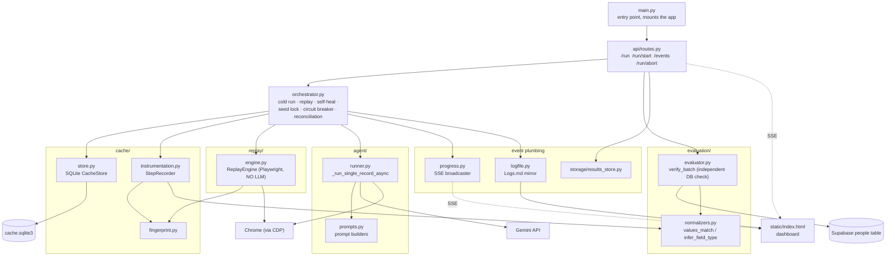

# CODE_TEMPLE_RUN.md — a guide to reading this codebase

Purpose: not a deep-dive, not line-by-line. This is an orientation map —
read it once before opening any `.py` file, so you already know what exists,
where it lives, and roughly what talks to what. Intermediate depth only:
file names, key functions/classes, who imports whom. For the deep "why"
behind specific mechanisms (circuit breaker, CDP, caching, etc.), see
`LEARNINGS.md` instead — this file is just the map to get you there.

3,625 lines of real code total, across 18 files. None of them are huge
except one (`orchestrator.py`), which is deliberately saved for last below.

---

## 1. The system at a glance

**Read this diagram as:** a browser request hits `main.py` → `api/routes.py`,
which calls into `orchestrator.py` — the one file that actually coordinates
everything else. The orchestrator reads/writes the cache (`cache/`), runs
deterministic replay (`replay/`) or live LLM calls (`agent/`) depending on
whether a step is cached, and after a batch finishes, `api/routes.py`
separately calls `evaluation/evaluator.py` to check Supabase directly
(never trusting the agent's own opinion). Everything that happens gets
mirrored out live to the dashboard via `progress.py`/`logfile.py`.

---

## 2. Reading order

Bottom-up — nothing below imports anything above it, so you'll never meet
an unfamiliar name before you've seen where it comes from.

# Thursdayyyyy

### Layer 0 — Foundations (read first)
1. **`config.py`** (87 lines) — every tunable constant
   (`MAX_CONCURRENT_REPLAYS`, `CDP_DEBUG_PORT`, `TARGET_FORM_URL`,
   `MATCH_KEY_FIELD`, Supabase/Gemini settings). No logic, just names
   you'll recognize everywhere else.
2. **`data/models.py`** (82 lines) — the real data shapes: `Record`,
   `RunResult`, `FieldResult`, `RecordVerification`, `BatchReport`. Once
   these click, every function signature elsewhere is self-explanatory.
3. **`data/loader.py`** (44 lines) — loads `sample_records.json` into
   `Record` objects.

### Layer 1 — Small, self-contained utilities
4. **`evaluation/normalizers.py`** (156 lines) — `infer_field_type()`,
   `values_match()`. "What counts as equal," reused by both the cache's
   field-matching and the DB verification.
5. **`cache/fingerprint.py`** (81 lines) — `compute_fingerprint()`. Used by
   both the cache-writer and the replay engine.

### Layer 2 — The cache layer
6. **`cache/store.py`** (285 lines) — `CacheStore`: the SQLite schema,
   `CachedStep`, `upsert_step`/`get_steps`, the thread lock.
7. **`cache/instrumentation.py`** (236 lines) — `StepRecorder`: the
   callback hooked into browser-use, `_match_field`/`_match_checkbox_field`.

# Fridayyyy

### Layer 3 — Replay (the LLM-free execution path)
8. **`replay/engine.py`** (172 lines) — `ReplayEngine`: `_locate()` (the
   2-tier locator), `perform()`.

### Layer 4 — The LLM/agent layer
9. **`agent/prompts.py`** (101 lines) — `build_task_prompt`,
   `build_step_prompt`, `build_reconciliation_prompt`.
10. **`agent/runner.py`** (258 lines) — `_run_single_record_async` (the
    core "run this through browser-use" primitive), `_detect_quota_exhausted`.
    Also still has v1's own `run_batch`/vision-fallback functions — present,
    but dead code as far as v2's real pipeline goes.

### Layer 5 — Verification (independent, only needs Layer 0/1)
11. **`evaluation/evaluator.py`** (163 lines) — `verify_batch`,
    `_find_matching_row`, `_compare_record`.

# Saturday

### Layer 6 — The orchestrator (the big one — read LAST)
12. **`orchestrator.py`** (1,322 lines — over a third of the whole
    codebase). Read it in this internal order:
    `resolve_path_variant` → `_run_cold` → `_run_live_fallback_step` →
    `_run_replay` → `_run_record_cached_async` (ties cold/replay/self-heal
    together per record) → `run_batch_cached`/`_run_many_concurrent_async`
    (the batch entry point) → the seed-lock/circuit-breaker section →
    the reconciliation section last.

# Sunday

### Layer 7 — Plumbing around the orchestrator
13. **`progress.py`** (56 lines) — `ProgressBroadcaster`, the SSE publish
    mechanism.
14. **`logfile.py`** (126 lines) — mirrors events into `Logs.md`.
15. **`storage/results_store.py`** (29 lines) — saves each `BatchReport`.

### Layer 8 — The HTTP layer
16. **`api/routes.py`** (305 lines) — `POST /run`, `POST /run/start`,
    `GET /events`, `POST /run/abort`, the background-thread wiring, the
    reconciliation kickoff.
17. **`main.py`** (13 lines) — mounts the router. Thirty seconds.

### Optional, read whenever
18. **`compare.py`** (109 lines) — standalone v1-vs-v2 comparison script,
    not part of the live app.
19. **`static/index.html`** — the dashboard frontend, not Python, separate
    from this backend reading order entirely.

---

## 3. Who calls whom — the short version

- `main.py` → `api/routes.py` (mounts its router)
- `api/routes.py` → `orchestrator.py` (`run_batch_cached`,
  `run_reconciliation_pass_sync`), `evaluation/evaluator.py`
  (`verify_batch`), `storage/results_store.py` (`save_report`)
- `orchestrator.py` → `cache/store.py` (`CacheStore`),
  `cache/instrumentation.py` (`StepRecorder`), `replay/engine.py`
  (`ReplayEngine`), `agent/runner.py` (`_run_single_record_async`),
  `agent/prompts.py` (`build_reconciliation_prompt`), `progress.py` /
  `logfile.py` (via the `on_event` callback passed down through nearly
  every function)
- `cache/instrumentation.py` → `cache/fingerprint.py`,
  `evaluation/normalizers.py`
- `replay/engine.py` → `cache/fingerprint.py` — **zero `browser_use`
  import**, deliberately, to keep cache-hit replay genuinely LLM-free
- `agent/runner.py` → `agent/prompts.py`, the `browser_use` library itself
  (Gemini calls happen only here)
- `evaluation/evaluator.py` → `evaluation/normalizers.py`

Only `orchestrator.py` imports from essentially every other module — that's
exactly why it's the heaviest file, and why it's placed last in the reading
order above.

---

## 4. How to use this

Read top to bottom, in order. When something in a file references a name
you haven't seen yet, it should already be covered by an earlier layer —
if it isn't, that's worth asking about directly. Bring questions as they
come up, same as the rest of this conversation.
