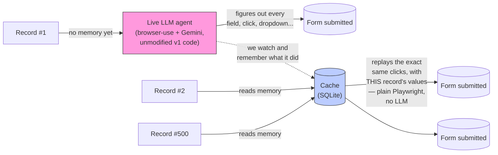
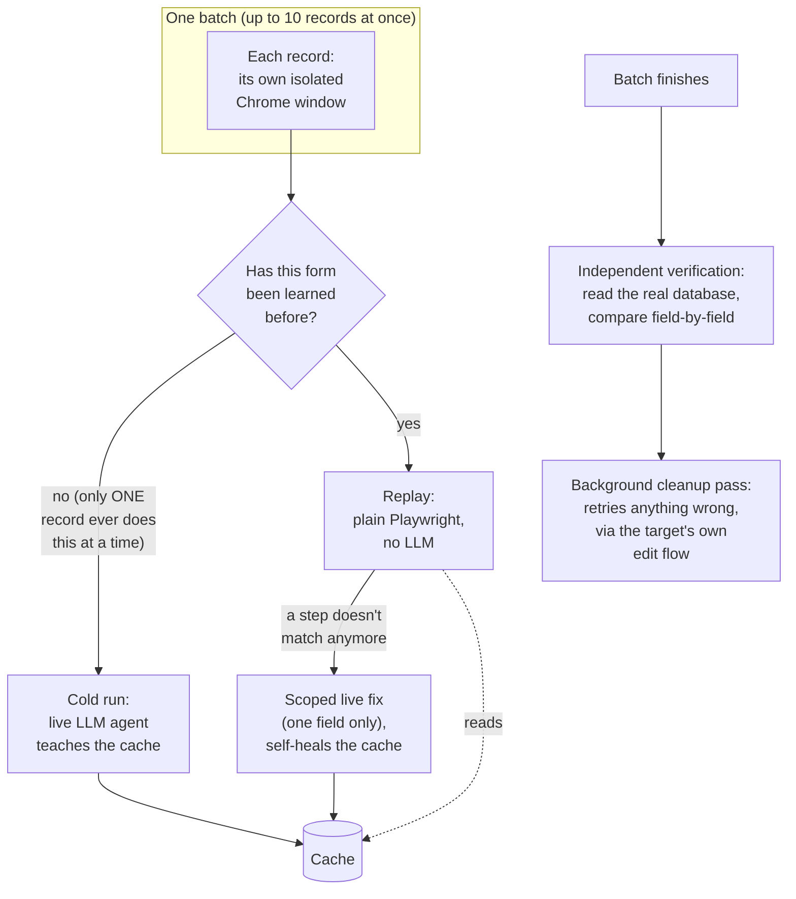

# terminautomator v2 — a caching layer for browser-automated data entry

*One-line version: v1 already proved an LLM can fill in a web form by
itself. v2 makes it so that after the very first record, it almost never
has to.*

---

## TL;DR

- **v1** (shown previously — that part was the baseline): an LLM
  (`gemini-3.5-flash-lite`, via an open-source library called
  `browser-use`) looks at a real web form and fills it in, one field at a
  time, one record at a time. It works, but it pays the same full
  "look-at-the-page, decide, act" LLM cost on every single field of every
  single record — record #500 costs exactly as much as record #1, even
  though the form itself never changed shape in between.
- **v2** (this — my own addition on top of v1): a caching/replay layer
  that sits around the exact same v1 agent, unmodified. Record #1 still
  uses the live LLM to learn the form. Every record after that replays
  those learned actions with plain browser automation — **zero LLM
  calls** — while the LLM stays fully wired in as an automatic,
  per-field fallback the moment anything doesn't match what was learned.
- **Net effect**: an estimated 5,000–7,500 LLM calls for a 500-record
  batch drops to roughly a few dozen. Per-record time drops from
  "15 seconds to a couple of minutes" (LLM-bottlenecked) to "well under a
  second" (browser-speed-bottlenecked) for every record after the first.

---

## 1. Where v1 left off

v1's job was narrow and it did it well: given one record's worth of field
values and a target web form, drive a real Chrome browser through
`browser-use` + Gemini and fill it in — reading the page, deciding what
each input is for by its label, typing/clicking, submitting. No hardcoded
selectors, no prior knowledge of the page — it figures the form out fresh
every time, which is exactly what makes an LLM-driven agent valuable over
a brittle hand-written script.

The problem that was never v1's job to solve: doing this **500 times in a
row for the same form**. The agent has no memory between records — it
re-discovers "the department field is a dropdown, third one down" from
scratch, at full LLM cost, for every single record, forever.

## 2. The problem, with real numbers

For a form like DataDesk's "Add Person" page (~18 fields: text inputs, a
date, several dropdowns, a checkbox, a notes box), a representative
estimate is **10–15 LLM calls per record** (a call to read the page, a
call per field or small batch of fields, extra calls when a dropdown needs
a moment to render). For 500 records, naively:

| | Naive (v1 alone, 500 records) | With v2's caching |
|---|---|---|
| LLM calls | ~5,000–7,500 | ~10–15 (record #1) + a handful more for anything genuinely new — often **a few dozen total** |
| Time per record (after the first) | 15s – 2 min, LLM-bottlenecked | well under 1s of actual work, browser-speed-bottlenecked |
| Safe to run many records concurrently? | No — Gemini's free tier caps out at 15 requests/minute, shared across every concurrent call | Yes — pure replay makes no LLM calls at all, so concurrency doesn't touch that limit |

That's not an incremental speed-up. It's a different cost curve entirely
— and it's the whole reason v2 exists as a caching layer rather than just
"run v1's agent 500 times."

## 3. The core idea

> **The first record that needs a form teaches the system where
> everything on it is. Every record after that just replays what was
> learned, dropping in its own values — no LLM call, unless something
> genuinely new comes up.**

Record #1 is expensive — the real LLM figures out the whole form, click by
click. Records #2 onward are nearly free — plain Playwright (a
non-AI browser automation library) replaying the exact interactions
record #1's run discovered, with *this* record's own values dropped in.
If something the cache doesn't recognize comes up (a genuinely new field,
a page that changed slightly), it falls back to the LLM for **just that
one thing**, fixes it, and remembers the fix — so no future record ever
pays for that gap again either.

## 4. How it actually works, without going into code

**We never modified browser-use's source.** It exposes a public hook —
`register_new_step_callback` — that fires after every action the live
agent decides to take. We plug a listener into that hook that watches
what the agent does and takes notes; browser-use has no idea caching
exists, it just keeps doing what it always did.

**What gets "learned" is data, not code.** For every action worth
remembering, we save: where the element is on the page (a locator), what
kind of action it was (click / type / select / checkbox), and — critically
— **which field it corresponds to**, figured out by matching the value the
LLM typed back against the source record's own field values. We never
cache the literal text that got typed, only *which field* it was — so
replay can safely drop in a *different* record's value for that same spot.

**Replay is a fixed, tiny dispatcher — not more LLM.** For record #2
onward, a completely separate, LLM-free tool (Playwright) reads the saved
locator, resolves it against the live page, and performs the one matching
action. No page-wide discovery, no "look at everything and decide" step —
it already knows exactly what to do and where.

**Nothing here trusts a "hope it still matches."** Locating a cached
element uses two independent strategies (exact path, then a backup
attribute selector) before falling back live — and if a step still can't
be replayed, the fallback is scoped to fix *just that one field*, on the
*same* browser tab, so whatever else replay already filled in stays
filled in.

**Correctness is checked independently, never self-reported.** After a
batch runs, a separate step reads what's actually sitting in the target
database and compares it field-by-field against what was meant to be
there. The automation's own opinion of "did it work" is never trusted for
grading — more on exactly why that discipline mattered in section 6.

## 5. Architecture at a glance

A few deliberate safety mechanisms worth knowing about, since they're the
difference between "works in a demo" and "doesn't collapse under real
concurrency":

- **Only one record ever cold-runs a given form at a time** — if ten
  records simultaneously find no cache yet, nine of them wait rather than
  all independently burning a live LLM call to discover the same thing.
- **A circuit breaker** stops repeatedly retrying a field that's clearly,
  currently broken (e.g. the LLM API itself returning errors) instead of
  every subsequent record queuing up for its own doomed attempt.
- **A background reconciliation pass** runs after every batch, retrying
  anything verification found wrong on a record that *did* land — closing
  the gap toward "eventually every field is fully correct," without
  blocking the main batch on it.

## 6. Does it actually hold up? — the debugging story

This is worth being direct about, because a caching layer that "usually
works" is worse than useless for real data entry — a silently wrong field
is worse than a slow one. So this project has been tested against a real
disposable rehearsal app (**DataDesk** — a small React + Supabase "People"
admin panel, built specifically so results could be checked independently
against a real database, not just trusted).

**16 real issues** have been found and fixed this way — not by guessing,
by actually running it against a live browser, a live LLM, and a live
database, and reading exactly what broke. A few worth naming, because
each one shaped a real design decision above:

| Issue | What it taught the design |
|---|---|
| A checkbox click replayed the *same* boolean for every record | Checkboxes needed state-aware replay (check current state, only click if it disagrees), not a blind repeat |
| A submit button got misidentified by position instead of identity | Submit is now found by *what it is* (the last click with no associated field), never by "whatever ran last" |
| Ten concurrent records all rediscovered the same missing field | A per-field lock now means only one record ever pays to learn something new; the other nine reuse the answer |
| A "successful" replay's database write hadn't actually landed yet | Success is now confirmed by waiting for the real database write to be observed, not a fixed guess-and-hope delay |
| Gemini's **daily** quota (not the per-minute one) ran out mid-demo | The system now detects that specific failure and aborts the rest of the batch immediately, instead of every remaining record independently discovering the same dead end |

The most recent live run is a good, honest example of this process
working exactly as intended, not a failure to hide: it came back at
**67.3% field accuracy with 15 records missing** — traced within the same
session to two root causes (some generated test values didn't match the
target form's real dropdown options, and a Supabase table that had never
been cleared across a full day of testing was slowing down under
concurrent load). Both were root-caused, fixed, and verified same day. An
**earlier, cleaner run under the same system had already reached 100%
field accuracy** — cited directly in this project's own bug log as the
baseline a later regression (the submit-misidentification bug above)
temporarily broke and was then caught and fixed via live retesting.

The honest summary: the caching *mechanism* has been correct and stable
for a while now. What keeps surfacing are exactly the kinds of things real
production automation has to survive — concurrency edge cases, timing
races, bad test data, third-party API quotas — and each one has a
documented root cause, a fix, and a verification step behind it, not a
guess.

## 7. Is this locked to DataDesk?

Short version: **no.** The entire caching/replay engine — the concurrency
handling, the cache itself, the replay logic — has zero DataDesk-specific
knowledge anywhere in it. Point `TARGET_FORM_URL` at a different form,
clear the cache, and record #1 would cold-run and teach the cache that
new form's layout the same way, with **zero code changes** to any of the
caching machinery. A couple of small, clearly-bounded pieces (one prompt
used only for the cleanup/reconciliation pass, and the fact that grading
currently reads a database directly, which DataDesk was specifically
built to allow) would need attention for a genuinely different target —
but that's a small, known, already-documented list, not an open question.

## 8. What's next

Deliberately not built yet, and written down rather than guessed at on the
fly:

- Broader form-field coverage (radio buttons, date pickers, multi-select —
  currently only click/text/dropdown/checkbox are cacheable)
- A second, differently-shaped test form, to prove portability with a real
  run instead of by reasoning about the code
- A pluggable verification strategy for a real target that won't offer
  direct database access the way DataDesk does — that's the one piece
  that's a deliberate simplification for this rehearsal stage, not
  something that would survive unchanged against a real ERP

## 9. Want more detail than this?

This file is the short version on purpose. The full documentation set
(architecture deep-dive, every bug's full write-up, a line-by-line code
walkthrough, an honest gaps-and-future-plans list) lives alongside this
project — start at `GUIDEBOOK.md` if a deeper read is ever useful.
